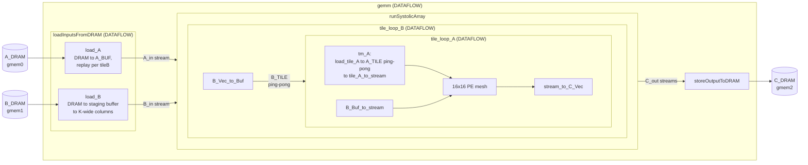

# GEMM with a Systolic Array on Versal (Vitis HLS)
 
An output-stationary systolic array for single-precision GEMM (`C = A × B`), written in C++ for **AMD Vitis HLS 2023.2** and targeting the programmable logic (PL) of the **Versal AI Core VC1902** (VCK190, `xcvc1902-vsva2197-2MP-e-S`).
 
This is the second project in the journey of my diploma thesis, titled *"Exploring GEMM methods on Versal ACAP platforms"*, at the ECE department of the University of Patras. It is a PL-only baseline. Later stages will bring in the AI Engines and compare PL, AIE and hybrid PL+AIE GEMM designs on the same chip.
 
---
 
## Results (current configuration)
 
| Parameter | Value |
|---|---|
| Problem size | I = 128, J = 128, K = 32 (fp32) |
| PE array | 16 × 16 = 256 PEs |
| DRAM word | `hls::vector<float, 16>` (512-bit) |
| Target clock | 300 MHz (HLS estimated Fmax: 303.12 MHz) |
| C simulation | Pass |
| C/RTL co-simulation | **Pass, 3,474 cycles** |
| C synthesis estimate | 3,086 cycles |
 
| Resource | Used | Device share |
|---|---|---|
| DSP | 256 | 13% |
| BRAM | 264 | 13% |
| FF | 443,074 | 24% |
| LUT | 298,403 | 33% |
 
**Throughput:** `2·I·J·K = 1,048,576` FLOPs in 3,474 cycles at 300 MHz (11.58 µs) is **≈ 90.6 GFLOPS**. Peak for this array is `256 PEs × 2 FLOP × 300 MHz = 153.6 GFLOPS`, so the design reaches **≈ 59 % of its own peak**.
 
Each PE maps to exactly one DSP58 (fp32 `fmacc` on the hard DSP), which is why the DSP count equals the PE count.
 
How to read these numbers:
 
- The co-sim and synthesis numbers are only about 13 % apart. When the project started the gap was 73 % (283 estimated against 490 measured), so the dataflow now behaves the way the scheduler predicts.
- In absolute terms 90 GFLOPS is small. The array uses only 13 % of the 1,968 DSPs, so the next step is to scale the array (see [Limitations](#known-limitations--future-work)).
- These are simulation results. The design has not been through Vivado implementation or run on hardware. Some modules show negative HLS slack because of the 0.9 ns default clock uncertainty, even though the overall Fmax estimate is above 300 MHz.
---
 
## Architecture
 

 
**Dataflow.** The top function `gemm` is a DATAFLOW region with three stages: DRAM load, compute, DRAM store. All three DRAM ports are `m_axi`, accessed through `hls::burst_maxi` with explicit `read_request` / `write_request` bursts.
 
**Tiling.** C is computed in `S_A_I × S_A_J` output tiles. The outer `tile_loop_B` walks column tiles and the inner `tile_loop_A` walks row tiles. Each tile performs the full K-reduction inside the array, so there are `NUM_TILES_I × NUM_TILES_J` array firings in total.
 
**Double buffering.**
- `A_TILE` is a ping-pong (PIPO) channel between `load_tile_A` and `tile_A_to_stream`. While the mesh consumes tile *n*, tile *n+1* is already loading.
- `B_TILE` is held `STABLE` across the `tileA` iterations that reuse it, and double-buffered across `tileB` iterations.
**PE (`pe.h`).** The PE is output-stationary:
- A values enter at the left edge and move right.
- B values enter at the top edge and move down.
- Each PE accumulates its own C element over K in a `PIPELINE II=1 rewind` loop, then writes it out.
- Template flags `PE<isLastRow, isLastColumn>` stop forwarding at the array edges, so no stream is left without a reader.
**Input streams.** `A_in` and `B_in` are single `hls::stream` channels, not arrays of streams. Every iteration of the tile loops therefore reads the same channel object, and the tool can recognise the buffers it feeds as reusable ping-pong channels.
 
### DRAM data layout (host contract)
 
| Matrix | Layout expected in DRAM |
|---|---|
| A | Row-major `A[I][K]`, packed as `VEC_SIZE`-wide words: `A_vec[I][K/VEC_SIZE]` |
| B | **Pre-tiled**: `B_vec[NUM_TILES_J][K/VEC_SIZE][S_A_J]`, where `B_vec[t][k][j][v] = B[k*VEC_SIZE+v][t*S_A_J+j]` |
| C | Row-major `C[I][J]`, packed as `C_vec[I][J/VEC_SIZE]` |
 
B is **not** plain row-major. A host or DMA stage has to write it in the tiled order above. `tb.cpp` (`initVectors()`) is the reference implementation of this packing.
 
---
 
## Repository layout
 
```
source/
  constants.h         Problem size, array size, VEC_SIZE, top-level prototype
  gemm.cpp            Top function: m_axi interfaces + top-level DATAFLOW
  dram.hpp            load_A, load_B, loadInputsFromDRAM, storeOutputToDRAM
  sa_functions.hpp    PE-mesh instantiation and the tile loops (runSystolicArray)
  tiling_manager.hpp  Tile buffers and conversions between buffers and PE streams
  pe.h                The processing element
  tb.cpp              Testbench: random A/B, golden fp32 GEMM, MSE check
build.tcl             csim + csynth + cosim (with dataflow profiling)
csim_only.tcl         C simulation only
run_settings.sh       Sources the Vitis 2023.2 environment (edit the path)
hls_project/gemm2/    Committed reports: gemm2.log and syn/report/*.rpt
```
 
---
 
## Building
 
Requirements: Vitis HLS **2023.2** with the Versal device files installed.
 
```bash
source run_settings.sh        # point it at your Vitis install first
vitis_hls -f csim_only.tcl    # functional check only (seconds)
vitis_hls -f build.tcl        # csim + synthesis + co-simulation (~15 min at this size)
```
 
- The testbench prints `MSE: <value>`. It should be 0, or very close to 0 because of float accumulation order.
- The synthesis summary is written to `hls_project/gemm2/syn/report/csynth.rpt`.
- The co-simulation latency is written to `hls_project/gemm2/sim/report/gemm2_cosim.rpt`.
- `build.tcl` runs co-sim with `-trace_level all -enable_dataflow_profiling`, so you can inspect the schedule and the FIFO/PIPO occupancy in the Vitis HLS GUI.
### Tool settings used (`build.tcl`)
 
| Setting | Why |
|---|---|
| `config_compile -pipeline_loops 0` | No automatic loop pipelining. Every pipeline in the design is explicit. |
| `config_array_partition -throughput_driven off -complete_threshold 1` | No automatic array partitioning. Every partition is explicit. |
| `config_compile -enable_auto_rewind` | Lets the PE pipelines rewind between invocations. |
| `config_compile -unsafe_math_optimizations` | Lets fp32 accumulation be reassociated. This can make results differ slightly from the strict C order. |
| `config_interface -m_axi_conservative_mode=0` | Removes the extra burst-staging buffer in the AXI adapter. |
| `config_storage fifo ... -auto_srl_max_bits 0 -auto_srl_max_depth 0` | Disables SRL-based FIFOs. This also pushes small FIFOs onto BRAM/LUTRAM, so revisit it if BRAM becomes tight. |
 
### Changing the configuration
 
Edit `constants.h`. The current code assumes:
 
- `I % S_A_I == 0`, `J % S_A_J == 0` and `K % VEC_SIZE == 0`. Nothing checks this, and other sizes give wrong results instead of failing.
- `S_A_J` is a multiple of `VEC_SIZE`, because `storeOutputToDRAM` packs one row of a tile into whole DRAM words.
- If `K / VEC_SIZE > 2`, partition the `B_BUF` staging array in `load_B` along `dim=1`. Otherwise its unrolled reads exceed the BRAM's two ports and HLS reports *"unable to schedule all read ports in the first II cycle"*.
---
 
## Development notes: what moved the numbers
 
The design reached its current state through a series of fixes. Each line below was confirmed with a co-sim trace or a report, not only reasoned about.
 
| Issue | Symptom | Fix |
|---|---|---|
| `A_TILE` declared `static`, with a malformed `#pragma HLS STREAM off ... type=pipo` | PEs sat in *FIFO EMPTY* because the next tile could not load while the current one was being consumed (490 cycles at 8×8) | Make `A_TILE` local and non-static and use a valid `type=pipo` pragma (490 → 407 cycles) |
| Each tile read a different element of `A_in[tileA][tileB]` | Ping-pong overlap still incomplete. HLS warnings 200-1449 / 200-1614 | Use one `A_in` stream for all tiles and have `load_A` buffer A once and replay it once per `tileB`. Same change applied to `B_in` |
| `B_TILE` ping-pong was inert | No overlap across `tileB` | DATAFLOW on `tile_loop_B` plus a single `B_in` stream |
| `STREAM` pragma on fully partitioned arrays | Warning 214-322 *"unsupported scalar variable"* | Harmless. Arrays passed between dataflow processes already default to PIPO channels |
| `load_B` assembled K-wide vectors using a runtime `k` offset, and wrote a vector on every iteration | **1.08 M LUTs (120 % of the device)** in barrel-shift `shl`/`and`/`or` logic, plus wrong data once `K > VEC_SIZE` | Two stages: copy the burst in DRAM order into a small buffer, then assemble each column with `k` unrolled (load_B: 1.08 M → 357 LUTs) |
| `m_axi` defaults (16 outstanding × 128-beat bursts × 512-bit words) | Tens of BRAMs per DRAM port | Size `num_*_outstanding` and burst length to the transfers the code actually issues (partly applied; see below) |
 
Experiments that did **not** help:
 
- **Deeper inter-PE FIFOs** (`K` → `2K`). Cycle count was unchanged, which shows the remaining stall comes from data dependencies and not from backpressure.
- **`hls::task` for the PE mesh.** It failed dataflow checking (*"can only be used in one process"*) for the PE-to-PE streams. A minimal chained-task test to tell whether this is a tool limitation is still to be done.
---
 
## Known limitations / future work
 
- **Wavefront fill is paid on every tile.** The inter-PE streams are local to `tile_loop_A`, so the mesh refills (about `S_A_I + S_A_J` cycles) on each of the `NUM_TILES_I × NUM_TILES_J` firings. Keeping the mesh alive across tiles would remove most of that cost. Two options are a persistent PE loop over all tiles or `hls::task`.
- **`C_out` is an `NUM_TILES_I × NUM_TILES_J` array of streams.** Its size grows with the product of the tile counts, which becomes impractical for large I and J. Turning it into a single stream requires buffering one row of tiles on chip so the output can still be written to DRAM in row-major order.
- **No support for sizes that are not multiples of the tile size.** There is no padding and no edge-tile logic yet. Adding `static_assert`s would at least make wrong sizes fail at compile time.
- **AXI tuning is per size.** `BURST_LENGTH` is a fixed constant and `num_*_outstanding` is left at its default. Both should follow the actual transfer sizes, and a single AXI4 burst is capped at 256 beats.
- **The cost of replaying A grows with `I × NUM_TILES_J`.** This can dominate the load stage when J is large.
- **Hardware validation.** The next steps are Vivado implementation (timing closure at 300 MHz), a run on the VCK190, larger arrays (higher DSP use), and the move to the AI Engines.
---
 
## References
 
1. AMD, *Vitis High-Level Synthesis User Guide* (UG1399), v2023.2. See the chapters on dataflow, `hls::burst_maxi`, `hls::task` and stream-of-blocks.
---
 
*Diploma thesis project, ECE, University of Patras.*
 
